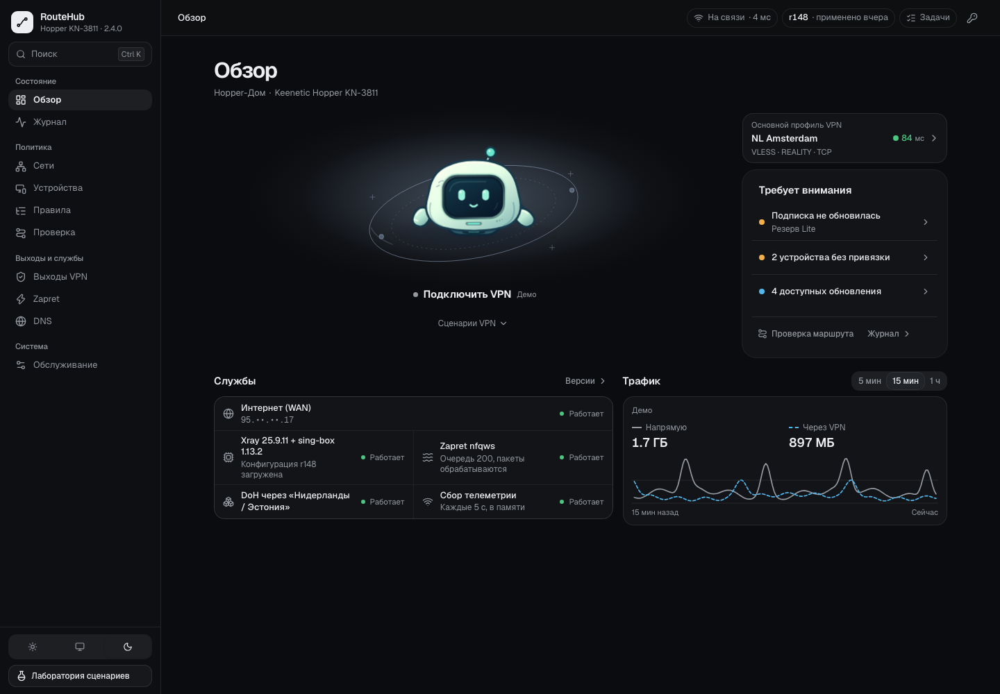
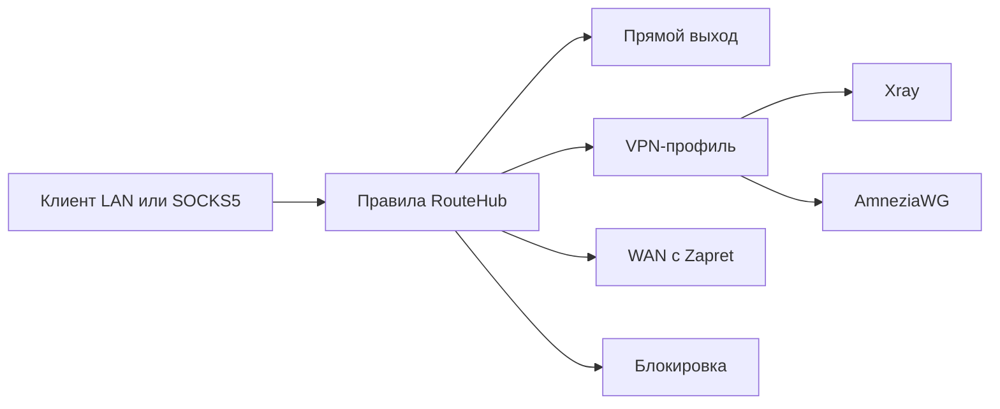

# RouteHub

**Раздельная маршрутизация для Keenetic через Entware.**

 · `Keenetic Hopper KN-3811` · `Entware ARM64`

RouteHub запускается на роутере и решает, куда направлять соединения домашней сети. Например, оставить Госуслуги на прямом подключении, направить отдельный сервис через AmneziaWG, а для Discord включить профиль Zapret. VPN-профили, правила, устройства и диагностика доступны в одной локальной веб-панели.

[Установка](docs/install.md) · [Сборка](docs/build.md) · [Перехват LAN](module/redirect/README.md) · [Демонстрационная панель](docs/build.md#демонстрационная-панель)

*Демонстрационная панель с вымышленными профилями, состояниями и трафиком.*

## Возможности

| Область | Что можно настроить |
| --- | --- |
| **Маршруты** | Выход по умолчанию и упорядоченные правила по доменам, адресам, CIDR, TCP/UDP и портам. Действия включают прямой выход, VPN-профиль, блокировку и Zapret при доступном адаптере. |
| **VPN** | VLESS, Hysteria2 и Trojan через Xray. AmneziaWG 2.0/3.1 через встроенный адаптер или совместимый интерфейс KeeneticOS. Импорт профилей, HTTPS-подписки VLESS, обновление каталога и параллельная проверка подключений. |
| **LAN** | Общие правила для одной настроенной IPv4-подсети и личные правила для клиентов с DHCP-резервом. Явный SOCKS5 доступен отдельно. |
| **DNS** | Обычный DNS, DoH, DoT, основной и резервный серверы, кэш, списки HaGeZi и исключения. Можно подключить управляемую домашнюю сеть к резолверу. |
| **Zapret** | Отдельные настройки YouTube и Discord, выбор стратегии и HTTPS-проверки. Для работы нужен совместимый `nfqws2` и поддержка NFQUEUE в системе. |
| **Обслуживание** | Импорт и экспорт маршрутов, ревизии плана, диагностика выхода, график трафика, CPU, памяти и диска, ограничение размера журналов. На ARM64 доступно обновление Xray. |

Маршрут определяется по первому подходящему правилу. Для IP-потоков и соединений, где домен недоступен, используйте IP-адреса и подсети. Панель объясняет выбор маршрута и отдельно проверяет доступность настроенного выхода.

## Совместимость

- Целевая модель — **Keenetic Hopper KN-3811** с ARM64 Entware (`aarch64-3.10`). Рабочая панель и туннель AmneziaWG проверены на этой модели.
- Перехват `redirect-tcp` покрывает TCP по IPv4. IPv4 TCP и UDP доступны в режиме `tproxy` при поддержке ядра. IPv6-трафик клиентов остаётся на штатном маршруте.
- Перехват управляет одной IPv4-подсетью. Отдельные политики для SSID, автоматический failover выходов и отправка DNS через VPN в текущей версии недоступны.
- Результат проверки HTTPS в Zapret подтверждает доступность проверяемого адреса. Потоковое видео и голосовые каналы проверяются отдельно.

## Исходники

| Каталог | Содержимое |
| --- | --- |
| [`module-rust/`](module-rust/) | Основной демон и библиотеки маршрутизации, импорта и VPN. |
| [`module/panel/`](module/panel/) | React-панель и режим демонстрации на тестовых данных. |
| [`module/`](module/) | Реализация на Go для совместимости, интеграции Entware и сборщик IPK. |
| [`docs/`](docs/) | Установка, сборка и локальные проверки. |

## Лицензия

Для RouteHub лицензия пока не указана. Тестовая фикстура v2fly сохраняет [свою лицензию](module/ruleimport/testdata/dlc/LICENSE).
